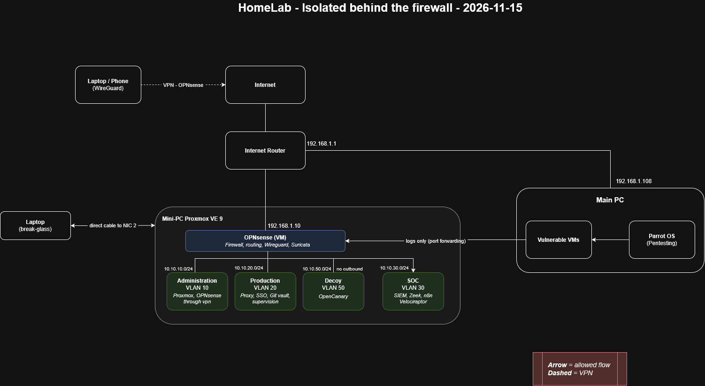

# Purple Team Homelab

A homelab built like a small company network: isolated zones, a SOC, and purple team exercises to test my own detections.

## Architecture

The lab is split into four zones (administration, production, SOC and decoys), each in its own VLAN behind an OPNsense firewall. The vulnerable machines live in an isolated network on a separate PC, and their only allowed flow is sending logs to the SOC. The house network never depends on the lab.

## Key decisions

| ADR | Decision |
| --- | --- |
| [0001](docs/adr/0001-isolate-proxmox-management-behind-opnsense.md) | Proxmox management only reachable from VLAN 10, with emergency access by direct cable |
| [0002](docs/adr/0002-bootstrap-opnsense-access-through-proxmox.md) | First access to OPNsense through the Proxmox host on VLAN 10, via an SSH tunnel |

## Risks

The main risks of the lab and their mitigations are listed in [docs/architecture/risk-register.md](docs/architecture/risk-register.md).

## Roadmap

| Phase | Goal | Status |
| --- | --- | --- |
| 0. Scoping | Architecture, first ADR, risk register | 🟡 In progress |
| 1. Foundations | Proxmox, OPNsense, VLANs, VPN | ⚪ Planned |
| 2. Services | Reverse proxy, SSO, password vault, backups | ⚪ Planned |
| 3. Automation | Ansible, OpenTofu, hardening | ⚪ Planned |
| 4. Detection | SIEM, Sysmon, Suricata, Sigma rules | ⚪ Planned |
| 5. Purple team | Active Directory attack and defense | ⚪ Planned |
| 6. Incident response | Velociraptor, decoys, full incident simulation | ⚪ Planned |
| 7. Showcase | Portfolio, write-ups, demo video | ⚪ Planned |

## Previous iteration

A first version is archived in [homelab-v1](https://github.com/CND-cyb/homelab-v1). It taught me the tools (pfSense, TrueNAS, Pi-hole, Tailscale), but it was a list of installed services with no real architecture: no segmentation, vulnerable machines on the same network as everything else, and no record of why things were built that way. This version starts from the design and documents every decision.
