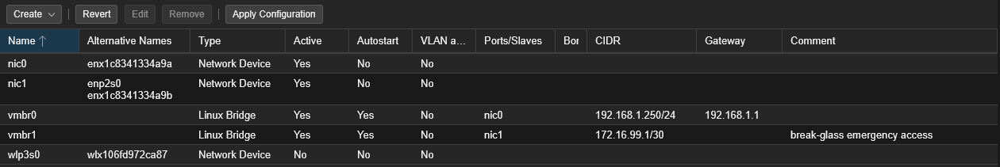
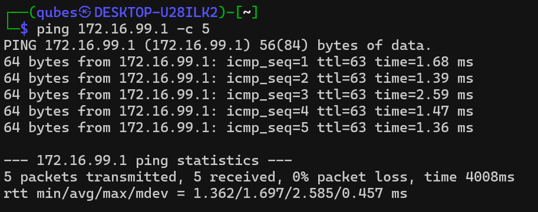
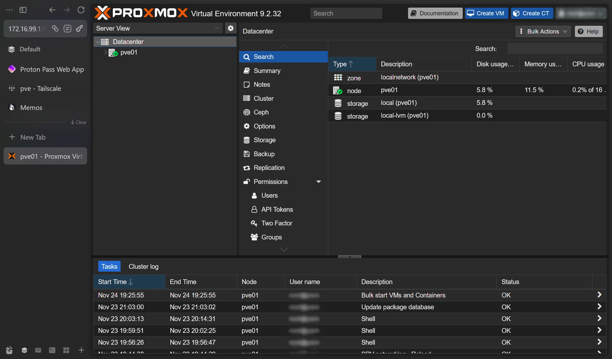

# Runbook — Break-glass access to Proxmox

- **Last tested:** 2026-11-24
- **Related decision:** [ADR 0001](../adr/0001-isolate-proxmox-management-behind-opnsense.md)

## When to use

This access allows us to reach Proxmox if there are any issues with OPNsense. During configuration and migration, there is also a risk of being locked out; this access addresses both situations.

## Prerequisites

- A laptop with an Ethernet port, and an RJ45 cable
- The break-glass port of the mini-PC (`nic1`): the Ethernet port that is **not** connected to the home router

> A "break-glass" label will be added on this port.

## Steps

1. Configure the laptop's Ethernet connection manually:
   - IPv4 address: `172.16.99.2`
   - Subnet mask: `255.255.255.252`
   - Gateway: leave empty
   - DNS: leave empty
2. Connect the RJ45 cable from the laptop to the break-glass port of the mini-PC.
3. Open `https://172.16.99.1:8006` in a browser. A certificate warning is expected: the certificate is self-signed.

## Verification

1. nic1 is active in Proxmox.
   
2. The laptop can ping the hypervisor.
   
3. The Proxmox login page loads.
   

## After the incident

1. Unplug the cable and store it near the mini-PC.
2. Reset the laptop's network settings to "Automatic".
3. Write an incident report describing the problem and how it was solved.
